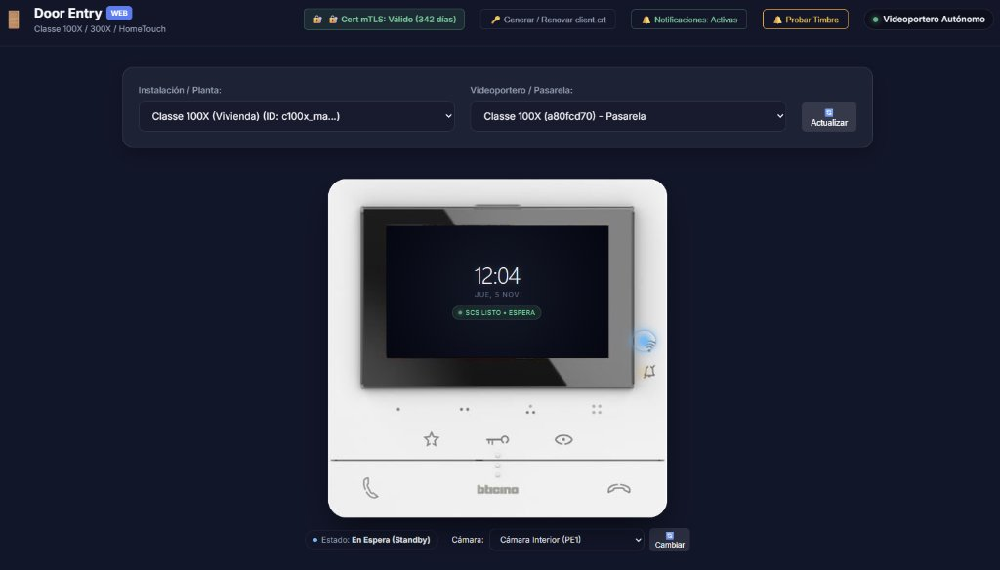

# DoorEntry Web & Intercom Bridge (BTicino / Legrand)

> [!WARNING]
> ### ⚠️ PROJECT STATUS: ACTIVE DEVELOPMENT (WORK IN PROGRESS)
> This repository is currently in **active development** and is **NOT a 100% fully stable or production-ready release**. Some features (such as bidirectional two-way audio PTT negotiation and multi-camera RTSP/SRTP bridging across complex NAT setups) are undergoing testing and experimental refinement. Use it for research, testing, or personal home lab experimentation. Contributions and bug reports are welcome!

<p align="center">
  
</p>

An autonomous web client and self-hosted bridge for **Legrand & BTicino video intercoms** (**Classe 100X**, **Classe 300X**, and **HomeTouch**). Developed through protocol analysis and reverse engineering of the official Android companion applications (`com.bticino.doorentrytouch` and `com.legrandgroup.c100x`).

It allows you to unlock doors, trigger staircase lights, monitor street cameras, answer doorbell rings, and control your intercom from any modern web browser or home dashboard (Home Assistant, tablet wall mount, PC), **without depending on official mobile apps**.

---

## ✨ Key Features

- **📱 Classe 100X Digital Twin Interface**: Interactive, pixel-accurate web overlay directly mapped to the physical BTicino Classe 100X wall intercom:
  - 🔑 **Key (Door Unlock)**: Sends OpenWebNet frames (`*8*19*20##` / `*8*20*20##`) and JSON-RPC pulses to unlock the main door.
  - 👁️ **Eye (Street View)**: Triggers auto-turn-on (30s timeout) for the entrance street panel camera.
  - ⭐ **Star (Light)**: Toggles the staircase light relay (`*8*21*114##`).
  - 📞 **Talk (Answer Call)**: Answers incoming ring calls or initiates microphone session.
  - 📵 **Hang Up (Release Channel)**: Releases the building 2-wire SCS bus and terminates stream sessions.
  - `•` **Dot 1 (Camera Switcher)**: Cycles between the primary entrance camera (**PE0**) and secondary/internal camera (**PE1**).
  - `••••` **Dot 4 (Snapshot)**: Takes and downloads a high-resolution snapshot from the active video feed.
  - 📶 **Wi-Fi LED & 🔔 Bell LED**: Live physical LED simulation for cloud connectivity and incoming doorbell ring strobes.
- **🛡️ Zero-Credential Daily Operation**: Works autonomously once authenticated via local mTLS client certificates (`client.crt` signed by Legrand CA).
- **📹 Live MJPEG / H.264 Pipeline**: Embedded RTP receiver and FFmpeg decoding pipeline delivering low-latency camera streams directly into HTML5.
- **🔄 Building SCS Bus Safety**: Enforces strict timeouts (30s) to guarantee the shared 2-wire building intercom bus is immediately freed up for other apartments.
- **🐳 Docker & Portainer Ready**: Minimal, non-root, hardened Docker container with healthchecks and multi-arch support (`amd64` / `arm64`).

---

## 🏗️ Architecture & Protocol Insights

```
┌────────────────────────────────────────────────────────┐
│                   Web Browser UI                       │
│    (Classe 100X Digital Twin + Live Stream Display)     │
└───────────────────────────┬────────────────────────────┘
                            │ HTTP / WebSocket
┌───────────────────────────▼────────────────────────────┐
│              DoorEntry Web Container                   │
│  FastAPI (Backend) + FFmpeg + VideoReceiver (UDP 9078) │
└─────────────┬───────────────────────────┬──────────────┘
              │ SIP / TLS (Port 5061)     │ SRTP / RTP
              │ mTLS with Legrand CA      │ H.264 Video
┌─────────────▼───────────────────────────▼──────────────┐
│            Legrand Eliot Cloud / Flexisip              │
│                 (vdesip.bs.iotleg.com)                 │
└───────────────────────────┬────────────────────────────┘
                            │ OpenWebNet over SIP
┌───────────────────────────▼────────────────────────────┐
│      BTicino Classe 100X Intercom Gateway (Local LAN)  │
│                   2-Wire SCS Bus                       │
└────────────────────────────────────────────────────────┘
```

1. **Authentication**: Uses Azure AD B2C OAuth2 to generate session tokens, then enrolls an elliptic-curve client certificate (EC `secp256r1`) signed by Legrand's non-public CA.
2. **Control Commands**: Commands are transmitted as OpenWebNet frames inside SIP `MESSAGE` payloads routed through Flexisip:
   - Door Lock: `*8*19*<bus_addr>##` followed by end-of-pulse `*8*20*<bus_addr>##`
   - Staircase Light: `*8*21*<light_addr>##` followed by `*8*22*<light_addr>##`
3. **Video Stream**: Initiated via SIP `INVITE` with SDP offering RTP/AVP (H.264, payload 96). The stream is decrypted and transcoded via internal FFmpeg pipe into browser-friendly MJPEG or snapshot frames.

---

## 🚀 Quick Start with Docker

### 1. Clone the repository

```bash
git clone https://github.com/uniextra/DoorEntry.git
cd DoorEntry
```

### 2. Configure environment variables (optional)

```bash
cp .env.example .env
```

Edit `.env` if you want to preset your timezone or host IP:

```env
TZ=Europe/Madrid
LOCAL_IP=192.168.1.50
```

### 3. Run with Docker Compose

```bash
docker compose up -d
```

Access the web interface at **`http://localhost:8080`** (or your server IP on port 8080).

---

## 📦 Docker Hub Image

Prebuilt multi-arch images (`linux/amd64`, `linux/arm64`) are automatically published to Docker Hub:

```bash
docker run -d \
  --name doorentry-web \
  --restart unless-stopped \
  -p 8080:8080 \
  -p 9078:9078/udp \
  -v ./data:/app/data \
  -e TZ=Europe/Madrid \
  uniextra/doorentry:latest
```

---

## 🛠️ Configuration & Port Mappings

| Port | Protocol | Purpose |
| :--- | :--- | :--- |
| `8080` | TCP | Web Interface & REST API |
| `9078` | UDP | External RTP Video Stream Receiver |
| `7076` | UDP | External RTP Audio Stream Receiver (experimental) |

### Volume Mounts

- `/app/data`: Stores generated mTLS certificates (`client.crt`, `client.key`), `session.json`, and persistent device tokens. **Keep this volume persistent across container updates.**

---

## 🗺️ Roadmap & Current Limitations

- [x] BTicino Classe 100X digital twin UI with capacitive buttons.
- [x] Door unlock with visual feedback (`*8*19*20##`).
- [x] Staircase light toggle (`*8*21*114##`).
- [x] Auto-turn-on street view (30s timer) with video stream decoding.
- [x] Incoming doorbell ring detection and browser notification.
- [x] Camera switcher (PE0 main entrance / PE1 internal camera).
- [ ] Stable two-way audio PTT (mic transmission to intercom outdoor station).
- [ ] Native Home Assistant integration (MQTT / Custom Component).
- [ ] Local direct SIP connection bypass when internet connection is down.

---

## ⚖️ Disclaimer & License

This project is an independent open-source initiative and is **not affiliated with, endorsed by, or associated with Legrand, BTicino, or Netatmo**. All trademarks, product names, and brand names are the property of their respective owners.

Distributed under the **MIT License**.
